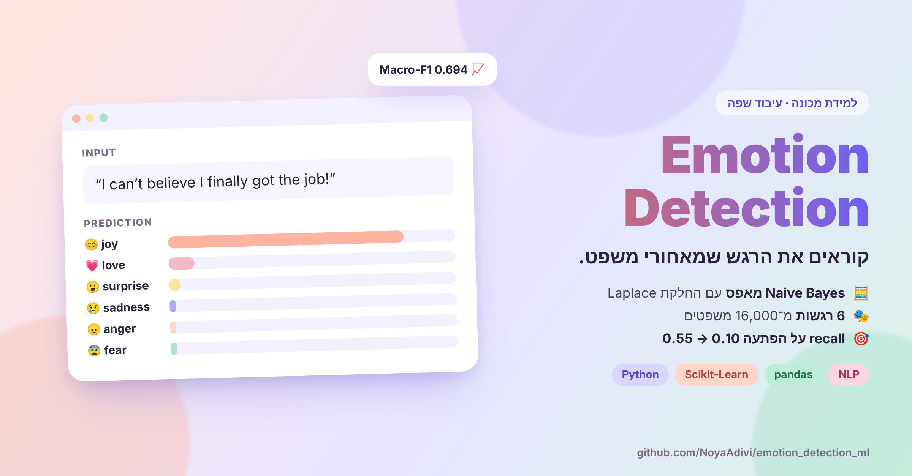
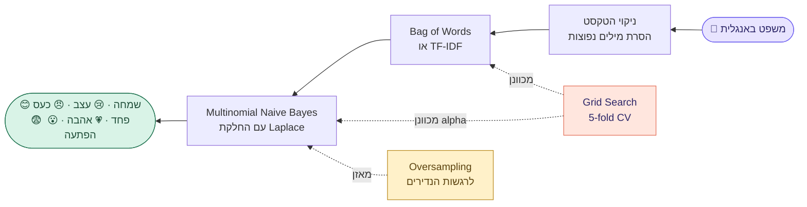

  

  
  
  

  
  
  
  

<h3 align="center">כותבים משפט באנגלית, והמודל אומר איזה רגש יש בו.</h3>

  מסווג <b>Multinomial Naive Bayes</b> שכתבנו מאפס, אומן על 16,000 משפטים כדי לזהות <b>שמחה, עצב, כעס, פחד, אהבה והפתעה</b>. פרויקט הגמר בקורס למידת מכונה ב־HIT.

<table align="center">
  <tr>
    <td align="center" width="25%"><a href="#how-it-works"><b>📚 16,000</b></a> משפטים מתויגים</td>
    <td align="center" width="25%"><a href="#how-it-works"><b>🎭 6</b></a> רגשות</td>
    <td align="center" width="25%"><a href="#results"><b>📈 0.694</b></a> Macro-F1 הכי טוב ב־CV</td>
    <td align="center" width="25%"><a href="#results"><b>🎯 0.10 → 0.55</b></a> recall על 'הפתעה'</td>
  </tr>
</table>

  

<table>
  <tr valign="top">
    <td width="33%">
<b>🧮 נבנה מאפס</b>
<ul><li><b>האימון והחיזוי</b> נכתבו ביד, בלי פונקציה מוכנה</li><li><b>החלקת Laplace</b> (alpha) למילים שלא הופיעו באימון</li><li><b>סינון מילים נפוצות</b> כדי להשאיר רק מילים עם משקל רגשי</li></ul></td>
    <td width="33%">
<b>🔬 כוונון נכון</b>
<ul><li><b>Grid Search עם 5-fold CV</b> על שיטת הייצוג ועל alpha</li><li><b>Bag of Words מול TF-IDF</b> על אותן חלוקות</li><li><b>Oversampling</b> כדי שרגשות נדירים לא ייבלעו</li></ul></td>
    <td width="33%">
<b>💡 אפשר להבין אותו</b>
<ul><li><b>Macro-F1</b> כדי שכל רגש ייספר באותה מידה</li><li><b>8 המילים</b> שהכי מעידות על כל רגש</li><li><b>תא הדגמה חי:</b> כותבים משפט ומקבלים רגש</li></ul></td>
  </tr>
</table>

ב־[מאגר הנתונים מ־Kaggle](https://www.kaggle.com/datasets/abhrajaiswal/emotions-detection-text-dataset) יש 16,000 משפטים מתויגים באנגלית, 80% לאימון ו־20% לבדיקה. המחברת מורידה אותו לבד.

| מודל | Macro-F1 בבדיקה | דיוק |
|---|:---:|:---:|
| בסיס (alpha = 1.0) | 0.63 | 78% |
| **אחרי כוונון ו־Oversampling** | **0.67** | 73% |

- **ההגדרה הכי טובה (5-fold CV):** Bag of Words עם alpha = 0.1, ממוצע Macro-F1 של **0.694** (TF-IDF הגיע ל־0.609).
- **Oversampling** העלה את ה־recall של הרגש הנדיר ביותר, *הפתעה*, מ־**0.10 ל־0.55**, במחיר קטן בדיוק הכללי. זו הבחירה הנכונה כשהמטרה היא Macro-F1.

  
  
  
  
  
  
  

1. לוחצים על , או מורידים את [`Notebook.ipynb`](Notebook.ipynb) ופותחים ב־Jupyter (`pip install -r` [`requirements.txt`](requirements.txt)).
2. מריצים את התאים לפי הסדר. הנתונים יורדים אוטומטית.
3. בתא האחרון כותבים משפט באנגלית ורואים את החיזוי.

<b>👥 הצוות:</b> נויה א. · עמית א. · אמיר מ.

  
  
  
  

