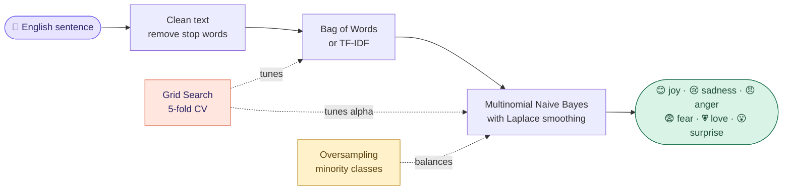

  

  
  
  

  
  
  
  

<h3 align="center">Type any English sentence and the model tells you how it feels.</h3>

  A <b>Multinomial Naive Bayes</b> classifier written from scratch, trained on 16,000 sentences to recognize <b>joy, sadness, anger, fear, love and surprise</b>. Final project of the Machine Learning course at HIT.

<table align="center">
  <tr>
    <td align="center" width="25%"><a href="#how-it-works"><b>📚 16,000</b></a> labeled sentences</td>
    <td align="center" width="25%"><a href="#how-it-works"><b>🎭 6</b></a> emotions</td>
    <td align="center" width="25%"><a href="#results"><b>📈 0.694</b></a> best CV Macro-F1</td>
    <td align="center" width="25%"><a href="#results"><b>🎯 0.10 → 0.55</b></a> recall on 'surprise'</td>
  </tr>
</table>

<table>
  <tr valign="top">
    <td width="33%">
<b>🧮 Built from scratch</b>
<ul><li><b>Training and prediction</b> written by hand, not a library call</li><li><b>Laplace smoothing</b> (alpha) for words never seen in training</li><li><b>Stop-word filtering</b> to keep only words with emotional weight</li></ul></td>
    <td width="33%">
<b>🔬 Tuned the right way</b>
<ul><li><b>Grid Search + 5-fold CV</b> over vectorizer and alpha</li><li><b>Bag of Words vs. TF-IDF</b> compared on the same folds</li><li><b>Oversampling</b> so rare emotions are not drowned out</li></ul></td>
    <td width="33%">
<b>💡 Explainable</b>
<ul><li><b>Macro-F1</b> so every emotion counts equally</li><li><b>Top 8 words</b> that point to each emotion</li><li><b>Live demo cell:</b> type a sentence, get an emotion</li></ul></td>
  </tr>
</table>

The [Kaggle dataset](https://www.kaggle.com/datasets/abhrajaiswal/emotions-detection-text-dataset) has 16,000 labeled English sentences, split 80% for training and 20% for testing. The notebook downloads it by itself.

| Model | Test Macro-F1 | Accuracy |
|---|:---:|:---:|
| Baseline (alpha = 1.0) | 0.63 | 78% |
| **After tuning + oversampling** | **0.67** | 73% |

- **Best configuration (5-fold CV):** Bag of Words with alpha = 0.1, mean CV Macro-F1 = **0.694** (TF-IDF reached 0.609).
- **Oversampling** raised recall for the rarest emotion, *surprise*, from **0.10 to 0.55**, at a small cost in overall accuracy. That is the right trade-off when the goal is Macro-F1.

  
  
  
  
  
  
  

1. Click , or download [`Notebook.ipynb`](Notebook.ipynb) and open it in Jupyter (`pip install -r` [`requirements.txt`](requirements.txt)).
2. Run the cells in order. The dataset downloads automatically.
3. Scroll to the last cell, type any English sentence and watch the prediction.

<b>👥 Team:</b> Noya A. · Amit A. · Amir M.

  
  
  
  

